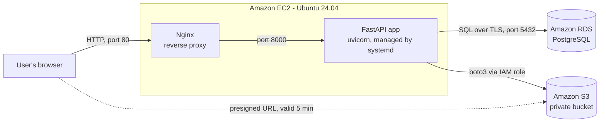
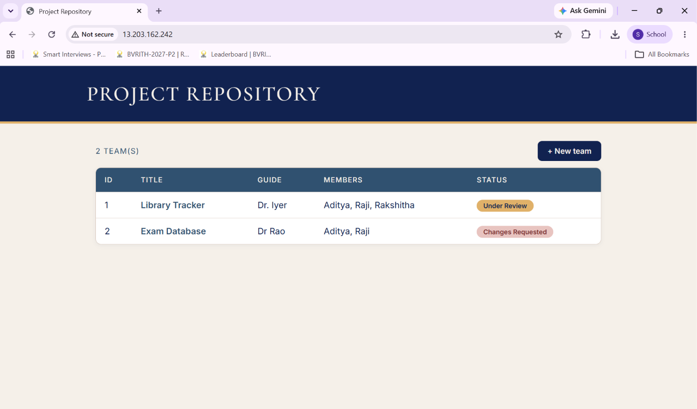
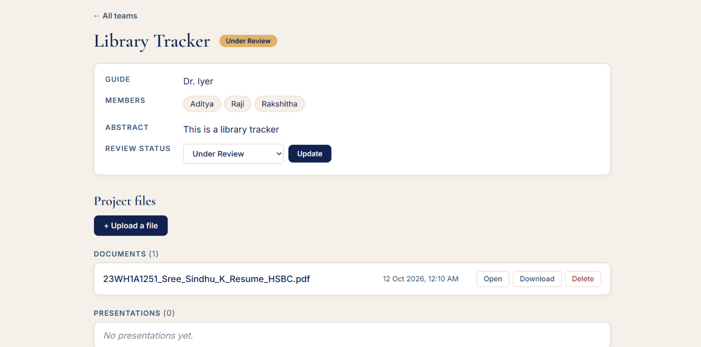
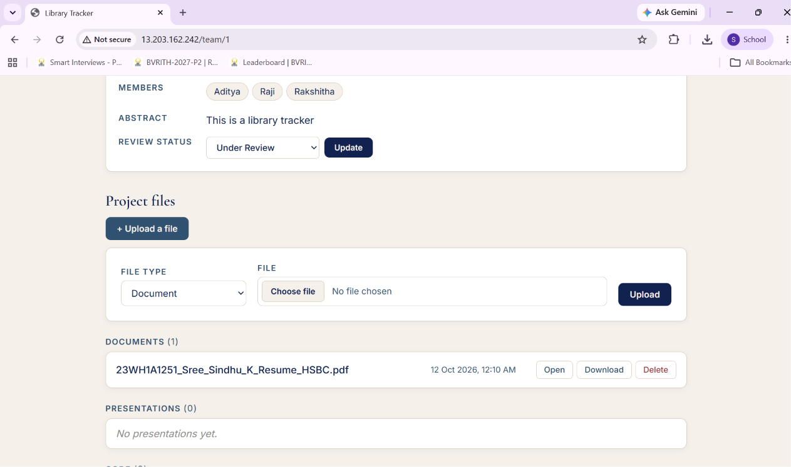
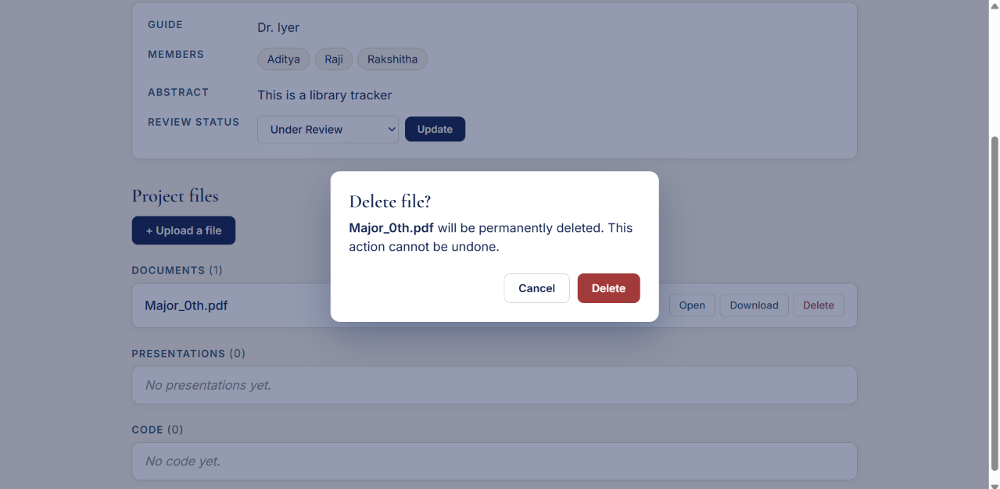
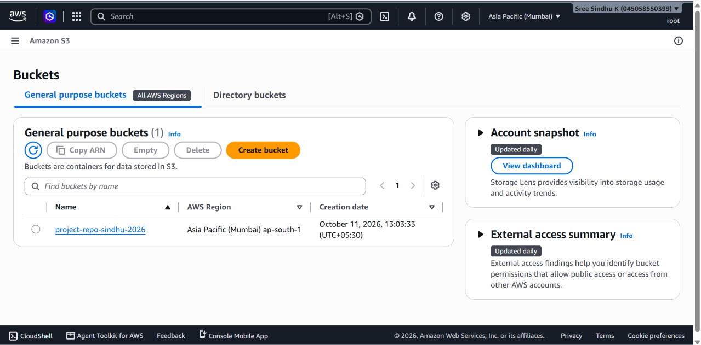
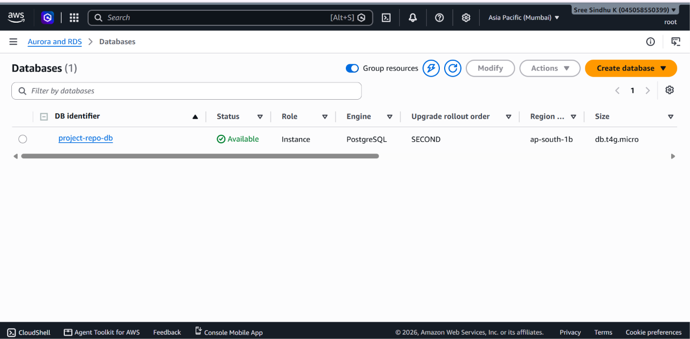
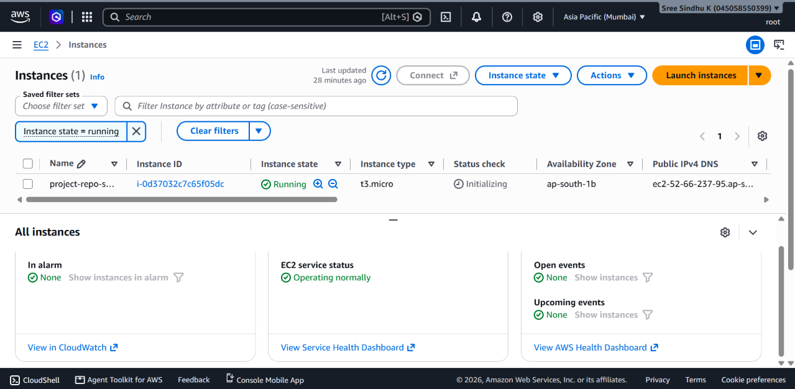

# Cloud-Based Project Repository

A web application where each final-year project team gets its own cloud workspace. Teams maintain their project title, abstract, guide, members, documents, presentations and code in one place, and guides track each project's review status.

Built for the Cloud Computing lab. The application runs on Amazon EC2, stores its data in Amazon RDS (PostgreSQL), and stores uploaded files in Amazon S3.

**Live demo (available during evaluation):** http://13.203.162.242

---

## Features

- **Team workspaces:** each team has a page showing the project title, guide, members and abstract.
- **File storage by type:** upload, open, download and delete Documents, Presentations and Code (.zip).
- **Review workflow:** status moves through Submitted, Under Review, Changes Requested and Approved, with a colour-coded badge.
- **Dashboard:** the home page lists every team with its guide, members and current status.
- **Safe deletes:** an in-page confirmation dialog appears before any file is permanently removed.
- **Private file access:** files are never public; downloads use temporary links that expire after 5 minutes.

---

## Architecture



How a request flows:

1. The browser sends a request to the server's Elastic IP on port 80.
2. Nginx receives it and forwards it to the FastAPI application on port 8000.
3. The application reads and writes team data in RDS, over an encrypted connection.
4. For uploads, the application streams the file to S3. For downloads, it generates a presigned URL and redirects the browser, which then fetches the file directly from S3.

### Security design

| Layer | Protection |
|---|---|
| S3 bucket | Block all public access is on. Files are reachable only through presigned URLs that expire after 5 minutes. |
| S3 permissions | The EC2 server uses an IAM role limited to this one bucket (list, read, write, delete). No access keys are stored on the server. |
| RDS | Not publicly accessible. Its security group accepts connections only from the EC2 server's security group. |
| RDS connection | TLS encryption is enforced (`sslmode=require`). |
| EC2 | SSH (port 22) is allowed only from the developer's IP. Only HTTP (port 80) is open to the public. |
| Secrets | Database credentials live in a `.env` file that is excluded from Git. |
| Uploads | Filenames are stripped of folder paths and given a random prefix, which prevents path traversal and overwrites. |

---

## Tech Stack

| Part | Technology |
|---|---|
| Backend | Python 3.12, FastAPI, Uvicorn |
| Database access | SQLModel (SQLAlchemy), psycopg 3 |
| Templates and UI | Jinja2, HTML, CSS |
| File storage | Amazon S3 (boto3) |
| Database | Amazon RDS for PostgreSQL |
| Hosting | Amazon EC2 (Ubuntu 24.04, t3.micro), Nginx, systemd |
| Access control | AWS IAM (role for EC2, user for local development) |

---

## Project Structure

```
Project-Repository/
├── main.py              # FastAPI routes: pages, forms, API, S3 upload/download/delete
├── database.py          # SQLModel tables (Team, ProjectFile) and the RDS connection
├── templates/
│   ├── base.html        # Shared layout: fonts, stylesheet, header
│   ├── index.html       # Home page: list of all teams
│   ├── team.html        # Team workspace: details, status, files, delete dialog
│   └── new_team.html    # Form to create a team
├── static/
│   └── style.css        # Theme (Sapphire, Royal Blue, Quicksand, Swan Wing, Shellstone)
├── check_s3.py          # Tests the S3 connection
├── check_db.py          # Tests the RDS connection and creates the database if missing
├── requirements.txt     # Python packages
├── .env.example         # Template for environment variables (no secrets)
└── .gitignore           # Excludes .env, venv, database files and uploads
```

---

## Routes

| Method | Path | Purpose |
|---|---|---|
| GET | `/` | Home page listing all teams |
| GET | `/team/{id}` | Team workspace page |
| GET, POST | `/new-team` | Form to create a team |
| POST | `/team/{id}/status` | Update the review status |
| POST | `/team/{id}/upload` | Upload a file from the browser |
| GET | `/files/{id}/download` | Redirect to a presigned S3 link (add `?inline=true` to open in the browser) |
| POST | `/files/{id}/delete` | Delete a file from S3 and the database |
| GET, POST, PATCH | `/teams`, `/teams/{id}`, `/teams/{id}/status`, `/teams/{id}/files` | JSON API (interactive docs at `/docs`) |

---

## Environment Variables

Copy `.env.example` to `.env` and fill in the values.

| Variable | Example | Notes |
|---|---|---|
| `AWS_REGION` | `ap-south-1` | Region of the S3 bucket |
| `S3_BUCKET` | `project-repo-sindhu-2026` | Bucket name |
| `AWS_ACCESS_KEY_ID` | | Local development only. Leave this out on EC2, where the IAM role is used. |
| `AWS_SECRET_ACCESS_KEY` | | Local development only. Leave this out on EC2. |
| `DB_HOST` | `xxxx.ap-south-1.rds.amazonaws.com` | RDS endpoint |
| `DB_PORT` | `5432` | |
| `DB_USER` | `repoadmin` | |
| `DB_PASSWORD` | | Never commit this. |
| `DB_NAME` | `projectrepo` | |

---

## Setup

### 1. Run locally (Windows PowerShell)

```powershell
git clone https://github.com/Sindhu2511/Project-Repository.git
cd Project-Repository
python -m venv venv
.\venv\Scripts\Activate.ps1
pip install -r requirements.txt
copy .env.example .env      # then fill in the values
uvicorn main:app --reload
```

Open http://127.0.0.1:8000. The RDS instance must be publicly accessible, and allow your IP, for local development to reach it.

### 2. AWS resources

1. **S3 bucket** in `ap-south-1`, with Block all public access turned on.
2. **IAM policy** limited to the bucket:

   ```json
   {
     "Version": "2012-10-17",
     "Statement": [
       {
         "Effect": "Allow",
         "Action": "s3:ListBucket",
         "Resource": "arn:aws:s3:::project-repo-sindhu-2026"
       },
       {
         "Effect": "Allow",
         "Action": ["s3:PutObject", "s3:GetObject", "s3:DeleteObject"],
         "Resource": "arn:aws:s3:::project-repo-sindhu-2026/*"
       }
     ]
   }
   ```

   Attach it to an **IAM user** (for local development keys) and to an **IAM role** for EC2.
3. **RDS for PostgreSQL**, `db.t4g.micro`, 20 GiB, with a security group allowing port 5432 only from the EC2 security group.
4. **EC2**, Ubuntu 24.04 `t3.micro`, with the IAM role attached. Its security group allows SSH from your IP and HTTP from anywhere.
5. **Elastic IP** associated with the EC2 instance.

### 3. Deploy on EC2

```bash
sudo apt update
sudo apt install -y python3-venv python3-pip git nginx
git clone https://github.com/Sindhu2511/Project-Repository.git
cd Project-Repository
python3 -m venv venv
source venv/bin/activate
pip install -r requirements.txt
nano .env            # AWS_REGION, S3_BUCKET and DB_* values only, no AWS keys
chmod 600 .env
```

**systemd service** at `/etc/systemd/system/projectrepo.service`:

```ini
[Unit]
Description=Project Repository FastAPI app
After=network.target

[Service]
User=ubuntu
WorkingDirectory=/home/ubuntu/Project-Repository
ExecStart=/home/ubuntu/Project-Repository/venv/bin/uvicorn main:app --host 127.0.0.1 --port 8000 --workers 2
Restart=always
RestartSec=3

[Install]
WantedBy=multi-user.target
```

```bash
sudo systemctl daemon-reload
sudo systemctl enable --now projectrepo
```

**Nginx site** at `/etc/nginx/sites-available/projectrepo`:

```nginx
server {
    listen 80;
    server_name _;
    client_max_body_size 50M;

    location / {
        proxy_pass http://127.0.0.1:8000;
        proxy_set_header Host $host;
        proxy_set_header X-Real-IP $remote_addr;
        proxy_set_header X-Forwarded-For $proxy_add_x_forwarded_for;
        proxy_set_header X-Forwarded-Proto $scheme;
    }
}
```

```bash
sudo ln -s /etc/nginx/sites-available/projectrepo /etc/nginx/sites-enabled/
sudo rm /etc/nginx/sites-enabled/default
sudo nginx -t
sudo systemctl reload nginx
```

### 4. Update the live server after code changes

```bash
cd ~/Project-Repository
git pull
source venv/bin/activate
pip install -r requirements.txt
sudo systemctl restart projectrepo
```

---

## Screenshots

| Screen | File |
|---|---|
| Home page with all teams |  |
| Team workspace |  |
| Upload form |  |
| Delete confirmation dialog |  |
| S3 bucket with team folders |  |
| RDS database (not publicly accessible) |  |
| EC2 instance with Elastic IP |  |

---

## Syllabus Mapping

| Lab experiment | Where it is covered in this project |
|---|---|
| **Exp 1:** Install VirtualBox/VMware with different OS flavours | Not covered here. The EC2 instance is itself a virtual machine running Ubuntu 24.04. |
| **Exp 3:** Create an EC2 instance, set up a web server, associate an IP address | EC2 `t3.micro` running Nginx as the web server, with an Elastic IP (`13.203.162.242`) associated. |
| **Exp 6:** Transfer files from one virtual machine to another | Files moved between machines with `scp` (see below). The application itself also moves every upload from the EC2 VM to S3. |
| **Exp 9:** Create a database instance in the cloud using Amazon RDS | RDS for PostgreSQL (`project-repo-db`) storing all team and file records. |
| **Additional:** Cloud object storage and identity | Amazon S3 for files, IAM user and role with least-privilege access. |

### File transfer between machines (Exp 6)

From a Windows laptop to the EC2 instance:

```powershell
scp -i "$env:USERPROFILE\.ssh\project-repo-key.pem" .\sample.pdf ubuntu@13.203.162.242:~/
```

From the EC2 instance back to the laptop:

```powershell
scp -i "$env:USERPROFILE\.ssh\project-repo-key.pem" ubuntu@13.203.162.242:~/sample.pdf .\downloaded.pdf
```

For a strict VM-to-VM demonstration, launch a second EC2 instance and run `scp` between the two, using their private IP addresses.

---

## Shutdown Plan (after evaluation)

Complete these in order to stop all charges.

1. **EC2:** EC2 > Instances > `project-repo-server` > Instance state > **Terminate**.
2. **Elastic IP:** EC2 > Elastic IPs > `13.203.162.242` > Actions > **Release Elastic IP address**. An Elastic IP that is not attached to a running instance is still charged.
3. **RDS:** RDS > Databases > `project-repo-db` > Actions > **Delete**. Choose "Create final snapshot" only if you want to keep the data. Snapshots are also charged for storage.
4. **S3:** S3 > `project-repo-sindhu-2026` > **Empty**, then **Delete**.
5. **IAM and networking:** delete the IAM user's access keys, the IAM user, the IAM role, and the security groups `project-repo-db-sg` and `launch-wizard-1`.

**Between lab sessions:** stop the EC2 instance and use **Stop temporarily** on RDS. The Elastic IP keeps the same address, but it is charged while the instance is stopped.

---

## Known Limitations

- No user login. Anyone with the link can create teams, upload files and change statuses.
- HTTP only. HTTPS would need a domain name and a TLS certificate.
- Members are stored as comma-separated text rather than linked user accounts.

## Possible Improvements

- Login with student, guide and admin roles, so that only guides can change review status.
- HTTPS using a domain name and a free Let's Encrypt certificate.
- Review comments from guides on each submission.
- Search and filtering by guide or status on the home page.